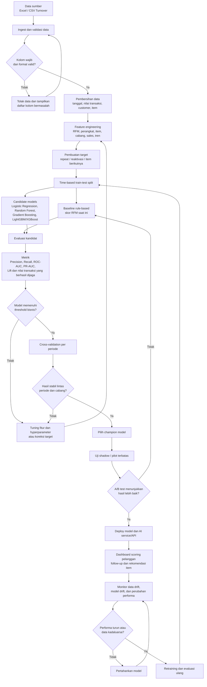

# Flowchart Pengembangan Model DCMS

Model masa depan bertujuan memprediksi probabilitas repeat purchase, risiko reaktivasi, dan rekomendasi item berikutnya. Model saat ini yang berbasis aturan RFM dijadikan baseline, lalu dibandingkan dengan beberapa kandidat machine learning menggunakan data historis.

## Rekomendasi Implementasi

- Gunakan model rule-based lama sebagai baseline agar peningkatan dapat diukur.
- Prioritaskan model Gradient Boosting atau LightGBM/XGBoost jika dataset cukup besar dan memiliki pola non-linear.
- Gunakan Logistic Regression jika fokus utama adalah interpretabilitas.
- Gunakan time-based split agar transaksi masa depan tidak bocor ke proses training.
- Tentukan threshold berdasarkan biaya follow-up dan nilai pelanggan, bukan sekadar mengambil threshold `0,5`.
- Jangan mengganti seluruh sistem sekaligus: jalankan model baru sebagai shadow/pilot dahulu.
- Retrain berkala berdasarkan performa dan ketersediaan data baru, misalnya bulanan atau saat metrik turun melewati batas.
